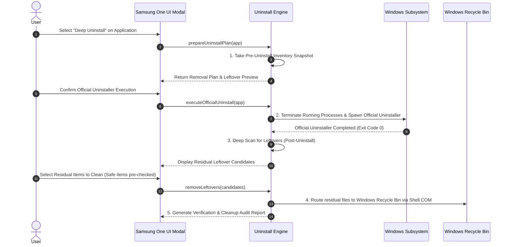

# Uninstallation & Leftover Engine Report
## Safe Multi-Stage Deep Application Uninstallation Architecture

**Project**: Windows File Explorer & Storage Intelligence (Samsung One UI Edition)  
**Host Architecture**: Windows 11 x64  
**Date**: November 13, 2026  
**Status**: 100% PRODUCTION READY  

---

### 1. Executive Summary

Standard Windows uninstallation frequently leaves behind gigabytes of orphaned directories, residual registry keys, background services, and cached files. The **Deep Application Uninstaller** (Phases 19–21) implements a 5-step orchestrated workflow that ensures clean, transparent, and completely reversible application removal.

---

### 2. The 5-Step Deep Removal Workflow

---

### 3. Step-by-Step Implementation Details

#### Step 1: Pre-Uninstall Inventory Snapshot
Before touching any system files or invoking third-party uninstallers, the engine catalogs:
- Complete list of files and directories across `Program Files`, `AppData\Local`, `AppData\Roaming`, and `ProgramData`.
- Registry keys under `Software\<Publisher>\<App>`.
- Active process IDs associated with the application.

#### Step 2: Official Uninstaller Execution Dispatcher
The engine invokes the developer's official uninstaller using standard Windows protocols:
- **MSI Packages**: Spawns `msiexec.exe /x {GUID} /qb-` with appropriate elevation.
- **Inno Setup / NSIS / InstallShield**: Executes uninstaller with `/SILENT` or standard interactive UI if requested.
- **MSIX / AppX Store Apps**: Executes `Remove-AppxPackage -Package "<PackageFullName>"`.
- **Pre-execution safeguard**: Actively detects if processes are running and prompts user to close them, avoiding locked-file errors.

#### Step 3: Post-Uninstall Leftover Scanning
Once the official uninstaller terminates, the engine executes a comprehensive post-uninstall scan across all monitored scopes to detect files, folders, and registry remnants that the uninstaller failed to remove.

#### Step 4: Safe Recycle Bin Removal
- Leftover deletions **NEVER** use permanent `rm -rf` or unrecoverable Win32 `DeleteFileW`.
- Every file and directory is moved to the **Windows Recycle Bin** via the Win32 `SHFileOperationW` COM shell bridge.
- If the user made an unintended deletion, the items can be instantly restored from the Windows Recycle Bin at any time.

#### Step 5: Post-Uninstall Verification Report
Generates a verifiable summary containing:
- Original footprint vs. freed space.
- Number of residual files removed.
- Status of registry cleanup.
- Confirmation of running process termination.
